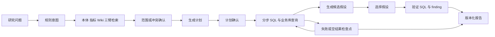

# 研究分析 → 研究会话：代码分析与优化建议

## 分析版本和边界

目标是 `/research`、`/research/:id` 的研究会话，以及 `/api/v1/research` 的独立研究状态机。

实际实现不在当前 main 中。已核对远程分支，本文使用包含较新研究会话改动的 `feat/multi-step-persist`，提交 `bf0e0bdd441fe9b32eb1b79191c9d651540f2790`。另一个包含研究入口的分支是 `feat/qwen-uplift-merge`。main 保持原版本和原工作目录；分析快照位于 `/workspace/research-review-bf0e0bd`。

此前 AIChatService 报告针对普通 chat。本文重新阅读研究会话的独立实现，不将普通 chat 的问题直接套用到研究模块。

## 当前实际功能

已有基础值得保留：研究域独立建模、用户归属校验、固定和动态检查点、检查点原子决策与过期时间、业务库只读适配器、模型选择、用量记录、报告版本、SSE 心跳，以及 REST 重建待决策状态。

`research / attribution / compare` 三种 mode 当前主要决定报告章节组织，执行链路基本相同。前端也有这一说明；将三种 mode 扩展为不同的研究方法，属于下一步能力提升。

最需要解决的是：研究问题和结果在相位之间传递不完整；验证状态没有表达证据是否支持假设；执行和事件仍依赖进程生命周期；报告没有充分呈现原始研究步骤的成果。

## 1. 高优先级：检查点恢复会丢失本轮研究问题

位置：[research_agent_stages.py:48](/workspace/research-review-bf0e0bd/backend/app/services/research_agent_stages.py:48)、[research_agent_service.py:287](/workspace/research-review-bf0e0bd/backend/app/services/research_agent_service.py:287)、[report_planner.py:395](/workspace/research-review-bf0e0bd/backend/app/services/report_planner.py:395)。

`runTurn` 使用本轮 question；`rebuildState` 在恢复时却重新取 `ResearchSession.input_seed`。检查点没有完整保存本轮问题。用户在某一检查点改写问题后，后续再次暂停恢复，也可能重新回到会话最初的问题。

**真实 API 已复现**：创建种子为“分析2025年采购总额”的会话，提交“只分析2024年订单数量”；确认范围后，新计划的 originalQuestion 变成“分析2025年采购总额”。

报告上下文也取会话最初问题，并读取会话全部 findings。报告 payload 虽带 turnId，其问题和结论范围没有严格按该轮绑定。累计研究报告可以保留，但应明确累计范围以及旧结论是否仍适用。

建议：保存版本化 `ResearchRunState`，至少包含 runId、rootTurnId、currentQuestion、parentRunId、mode、时间/指标/过滤、数据源/schema、模型、已确认决策和阶段结果引用。恢复从该 run 的快照开始。区分“本轮报告”和“累计报告”，累计报告显式纳入旧结论并记录替代/冲突关系。

验收：首轮 2025 → 追问 2024 → 修改为仅华东 → 再确认计划 → 报告，应全程保持本轮的 2024/华东范围。

## 2. 高优先级：假设生成和报告解读缺少实际业务数值

位置：[research_agent_ports.py:478](/workspace/research-review-bf0e0bd/backend/app/services/research_agent_ports.py:478)、[research_agent_stages.py:139](/workspace/research-review-bf0e0bd/backend/app/services/research_agent_stages.py:139)、[report_planner.py:221](/workspace/research-review-bf0e0bd/backend/app/services/report_planner.py:221)。

步骤结果摘要只写“返回 N 行，列：…”；`dataSummary` 将这类摘要传给假设 LLM。报告 LLM 的 finding 摘要主要包含断言、置信度、已验证状态和行数，没有实际数值统计。

**边界检查已复现**：对 `2024 amount=100 / 2025 amount=200` 的结果，假设输入只有“返回2行，列：year、amount”；报告解读输入只有“采购增长（置信度0.9，已验证，2行）”。模型无法据此计算增长比例或识别变化来源。

建议保留受控的确定性 `EvidenceSummary`：总量、同比/环比、基线、差值、分布、Top N、异常、缺失率、样本、单位和绝对时间范围。原始结果落持久化 resultRef，摘要按问题选取。报告文字引用明确的统计事实和证据 ID。

验收：输入 100 → 200 时，摘要包含基线100、当前200、差值100、增长100%；无数据时禁止输出相应趋势判断。摘要与报告数字做一致性检查。

## 3. 高优先级：“SQL 无错误”被标为“假设已验证”

位置：[research_agent_phases.py:265](/workspace/research-review-bf0e0bd/backend/app/services/research_agent_phases.py:265)、[report_planner.py:160](/workspace/research-review-bf0e0bd/backend/app/services/report_planner.py:160)。

验证相位以 `outcome.error is None` 判断 verified；报告视图采用相同判据。置信度使用候选相关分数乘 0.9 或 0.3，没有判断查询结果是否支持假设。

**已复现**：一个断言“采购金额上升”的 finding，验证返回 `support_count=0`、error=None，仍得到 verified=True。空结果也能满足该判据。

建议定义 `HypothesisTest`：断言、业务范围、待观察指标、基线/对照、预期方向或阈值、验证计划、判定条件和证据来源。结果分别记录 supported、contradicted、inconclusive、execution_failed；另存 executionSucceeded。候选检索分只用于候选排序，证据强度由实际测试与数据质量决定。

因果分析还需要记录替代解释、混杂因素和方法限制。单次 SELECT 成功不应提高因果断言的可信度。

验收必须包含：有支持数据、反向数据、零支持、空结果、SQL失败、样本不足和基线缺失。

## 4. 高优先级：计划修改分支存在运行时 NameError

位置：[research_agent_service.py:297](/workspace/research-review-bf0e0bd/backend/app/services/research_agent_service.py:297)。

`MAX_REPLAN_PER_TURN` 未导入或定义；上限分支还使用未定义的 options。Ruff F821 确认两个未定义符号，已有两条研究状态机测试也触发 NameError。

**真实 API 已复现**：对 planning checkpoint 提交 `modify + {instruction: "按月份分组"}`，接口返回200，但后台恢复失败，会话实际变为 failed。

当前 UI 的修改提交 `{question: ...}`，会先进入完整改写路径，因此不能将上述问题描述成“所有修改按钮必然报错”。这里还存在语义不一致：计划修改文本被当作新问题，从 ESL 重跑；“只增加按月分组”未必保留原研究范围。

建议先修复未定义符号，再使用按 phase 分型的 choice：范围修改、指标选择、计划编辑、假设选择和失败恢复分别校验。将“重写整个问题”与“调整已确认计划”作为两个明确动作。修改后生成计划差异，必要时再次确认。

## 5. 高优先级：会话未限制同时运行或待决策的研究轮次

位置：[research.py:385](/workspace/research-review-bf0e0bd/backend/app/api/v1/research.py:385)、[research_session_service.py:124](/workspace/research-review-bf0e0bd/backend/app/services/research_session_service.py:124)、[ResearchSessionPage.tsx:54](/workspace/research-review-bf0e0bd/frontend/src/pages/research/ResearchSessionPage.tsx:54)。

提交新 turn 只校验归属，没有拒绝 running/awaiting_user 状态。前端提交按钮也没有绑定执行中禁用和请求幂等。turn_index 使用 max+1，无锁；表没有对应的唯一约束。

**真实 API 已复现**：第一轮停在范围确认时，再提交第二轮，两次均返回202，留下两个 pending checkpoint。详情只显示最新一个，旧决策点容易失去正常交互入口。实际并发还可能导致报告发布冲突、事件混杂或状态被相互覆盖。

建议会话维护 activeRunId；创建 turn 时以数据库原子操作认领执行权。决定是否拒绝、排队或新建研究分支；请求携带幂等键。turn_index/version 加唯一约束并采用明确的并发分配机制。前端按钮只反映服务端状态，最终约束落在后端。

## 6. 高优先级：后续轮次和故障情况下 SSE 生命周期不完整

位置：[research.py:497](/workspace/research-review-bf0e0bd/backend/app/api/v1/research.py:497)、[useResearchSession.ts:24](/workspace/research-review-bf0e0bd/frontend/src/hooks/useResearchSession.ts:24)、[researchStore.ts:266](/workspace/research-review-bf0e0bd/frontend/src/stores/researchStore.ts:266)、[researchStore.ts:317](/workspace/research-review-bf0e0bd/frontend/src/stores/researchStore.ts:317)。

研究 done 会关闭 SSE；hook 的建流主要随 sessionId/pendingQuestion 变化执行。后续 submitTurn 和 answer 没有统一确保新流已就绪。

**额外前端检查已复现**：完成后调用 submitTurn 不会建立新流，streaming 仍为 false；连接失败时 store 仍调用 onOpen，首轮 hook 可以因此继续提交。onOpen 在 HTTP响应可读时触发，也没有等待后端 research.connected 的明确订阅确认。

建议提供统一 `executeAction`：确认研究对象和runId → 建立/恢复订阅 → 等 connected → 提交动作 → 等服务端终态。连接失败应返回失败结果，避免以成功回调解除等待。EOF、网络中断与真正 done 分开；补充重连和状态查询。

所有事件带 sessionId、runId、turnId、eventId和状态版本，前端按目标 run 更新。SSE 分块解析应保留跨块 CR；未知/不合法载荷需要可观察的诊断。

## 7. 多进程和重启兼容：任务与事件需要持久化

位置：[research_event_bus.py:32](/workspace/research-review-bf0e0bd/backend/app/services/research_event_bus.py:32)、[research.py:529](/workspace/research-review-bf0e0bd/backend/app/api/v1/research.py:529)。

当前任务用进程内 BackgroundTasks，事件是进程内广播队列，未提供历史回放，队列满丢旧事件。检查点可以恢复暂停态，但 worker 在执行中重启时，活跃任务和未保存相位状态没有完整恢复路径。

这是当前单进程实现的边界；本次未运行多worker或故障注入实验，不将其写成已复现部署事故。

建议渐进引入 ResearchRun 与阶段结果记录、worker租约/心跳、持久化任务队列和 event outbox。SSE作为持久事件的传输层，支持 lastEventId；队列丢消息时通知客户端重建状态。取消、超时、重试和恢复都归同一个运行状态机管理。

checkpoint options、report payload和event payload增加 schemaVersion，并提供旧快照迁移/拒绝策略，防止版本升级后续跑旧检查点时形状不兼容。

## 8. 数据类型和数据源兼容需要在边界统一

位置：[research.py:501](/workspace/research-review-bf0e0bd/backend/app/api/v1/research.py:501)、[research_sql_runner.py:72](/workspace/research-review-bf0e0bd/backend/app/services/research_sql_runner.py:72)、[research_agent_execution.py:266](/workspace/research-review-bf0e0bd/backend/app/services/research_agent_execution.py:266)。

研究 SSE直接 json.dumps，没有金额/日期适配。业务适配器返回原始字典，PostgreSQL NUMERIC 和日期、Oracle日期等是常见结果。

**序列化边界已复现**：Decimal 和 date 的 research.step.data 帧均抛 TypeError。包含行数据的 finding/report JSONB 也需要采用同一序列化契约；本次没有完整复现每种数据库的落库路径。

runner 的1000行上限在 adapter全量读取之后截断，不能限制底层读取内存。finding再截成100行，报告仍可能只给总行数，缺少结构化 truncated信息。

建议定义版本化 QueryResult：列类型、decimal精度、日期与业务时区、rows/resultRef、total/returned、truncated、schemaVersion和数据快照。数据库执行层支持有界读取或分页；结果导出与模型摘要分别处理规模。

NL2SQL生成只传子问题、本体类和方言，没有显式传递主问题范围、跨步实体集合、JOIN目录、已确认指标公式和Wiki业务规则。应补齐ExecutionContext，按数据源/schema筛选本体；假设验证SQL也通过同样的方言和schema约束生成。

## 9. 语义确认应真正改变执行，三臂检索需要区分冲突与相关

位置：[enterprise_semantic_layer.py:87](/workspace/research-review-bf0e0bd/backend/app/services/enterprise_semantic_layer.py:87)、[research.py:217](/workspace/research-review-bf0e0bd/backend/app/api/v1/research.py:217)、[CheckpointCard.tsx:433](/workspace/research-review-bf0e0bd/frontend/src/components/research/CheckpointCard.tsx:433)。

指标匹配适配层给 formula=None；计划主要获得BO物理表提示。知识片段主要用于最终报告引用，未完整进入业务规则约束。两篇高相关Wiki就产生 wiki_disagree 信号，未检测事实内容是否真的矛盾。

冲突卡片主要展示候选，没有完整的候选选择与计算绑定契约；scope确认并不保证用户选择的口径进入实际SQL。计划修改和范围修改也共用自由文本question。

建议三臂返回版本化SemanticScope：业务对象、指标定义与单位、物理映射、时间和过滤、规则引用、质量/权限信息。确认以结构化选择生成新scope版本，后续plan与SQL引用该版本。相关文档多篇可以合并；只有事实/有效期/口径冲突时请求用户决策。

固定检查点的 reject 当前文案说明“放弃当前检查点，按原计划继续”，与实现相符；这里不是新发现的代码偏差。功能上更适合明确区分“跳过确认”“重新选择”“取消研究”“生成部分报告”，并建立每个phase的动作表。

## 10. 报告应保留基础查询成果，并闭合证据回放

位置：[research_agent_phases.py:242](/workspace/research-review-bf0e0bd/backend/app/services/research_agent_phases.py:242)、[report_planner.py:509](/workspace/research-review-bf0e0bd/backend/app/services/report_planner.py:509)、[report_planner.py:252](/workspace/research-review-bf0e0bd/backend/app/services/report_planner.py:252)、[ReportRenderer.tsx:139](/workspace/research-review-bf0e0bd/frontend/src/components/research/ReportRenderer.tsx:139)。

最终数据章节读ResearchFinding，而finding主要由假设验证生成。前面的基础查询结果以进度事件和简要步骤状态存在；没有假设、用户不验证或验证失败时，基础研究成果无法完整成为最终报告的数据章节。

chart块固定 chartType=null，前端以表格渲染。sourceRefs已解析但没有在报告中提供证据跳转。时间线有agent角色展示支持，但主状态机主要追加用户和checkpoint轮次，最终agent结论没有形成完整的会话回复。

建议基础步骤独立保存 ResearchStepResult 和 ResultSnapshot，报告直接引用它们；假设验证是另一种证据来源。报告保存本轮目标覆盖、成功/失败/跳过步骤、口径与数据范围、图表、可验证引用及限制。报告发布后追加简明agent回复，再链接完整报告。

恢复真实图表和证据面板，支持SQL、数据摘要、数据源版本和生成时点的回放。多轮报告可标记新证据、失效旧结论和变更原因。

## 11. 研究模式和跨会话比较可以进一步成为业务能力

当前mode主要控制章节模板。compare报告列出claim/置信度/行数/SQL，尚未建立“比较对象、基线、同单位指标和差异计算”的业务模型。跨会话比较固定取executive_summary，attribution/compare模式没有该章节时会缺少对应摘要。

建议：

- research：先分解研究目标，完成描述性查询、事实摘要、知识解释，再按需要提出假设。
- attribution：保存基线和变化事实，设计可验证候选原因，明确支持/反驳/不确定及替代解释。
- compare：显式选择对照对象、期间、指标、单位和口径；差异数值用代码/SQL计算，再生成解释。

报告提供跨模式通用summary契约。比较页锁定具体报告版本并校验可比性；网络/权限失败与“没有报告”分别显示。

## 12. 模型协议、成本和恢复策略

研究已经具备显式模型选择、可用性筛选和预算路由，这些能力应保留。后续重点是按阶段匹配context/结构化输出/SQL方言提示能力，支持具体提供方协议与参数差异。

`LlmUsageRecorder`按返回modelName反查配置，别名不匹配时成本记0；`MeteredClient`主要累计成功返回的usage。建议每次调用带实际modelConfigId和价目版本，未知成本/用量显式记录unknown，失败时保存已知消耗。

增加整轮deadline、成本/调用次数预算、可选阶段预算，以及错误分类：模型临时故障、协议不支持、SQL语法、权限、业务库连接、无数据分别选择合适恢复。辅助解释失败可以降级，失败不能被包装成已完成研究。

## 建议落地顺序

| 阶段 | 交付重点 | 核心验收 |
|---|---|---|
| 第一阶段：修复确定性缺陷 | 本轮状态恢复、F821、运行互斥、续轮订阅、数据序列化 | 追问不回到首轮；修改不后台失败；只存在一个活跃run；每轮有终态与进度 |
| 第二阶段：建立研究证据契约 | 实际数值摘要、HypothesisTest、ResultSnapshot、scope/执行上下文、报告范围 | 零支持数据不标支持；数字能回溯；基础结果不依赖假设才能进入报告 |
| 第三阶段：增强兼容与体验 | 持久任务/事件恢复、版本化快照、阶段模型能力、三mode策略、图表和证据回放 | 重连/重启可续跑；模型/数据源切换有明确约束；研究和比较可完整复现 |

建议以业务场景而非仅API状态码验收：首轮/追问/改写/拒绝、重复提交、待确认再提交、空结果、零支持/反向结果、没有假设、部分失败、Decimal/日期、跨数据源schema、模型不可用、断网重连、worker重启、旧checkpoint恢复、报告版本和跨mode比较。

指标包括：问题范围保留率、子目标完成率、支持/反驳判定正确率、事实与引用覆盖率、恢复成功率、重复执行率、真实成本和各阶段延迟。先采集基线，再设置目标。

## 验证结果和限制

- 使用独立PostgreSQL测试库，对该分支执行Alembic迁移到0117；原main测试库和业务库没有用于本次写入。
- 5组现有后端研究集成测试完整执行：**102通过、3失败**。其中两条复现MAX_REPLAN_PER_TURN未定义；另一条测试设置autoConfirm=True后却要求存在pending检查点，属于测试配置/期望不一致。首次连接URL不含密码导致的3个适配器fixture错误，通过明确空密码URL修正后消失。
- 5组现有前端研究测试：**95通过**。
- 该分支的TypeScript/Vite生产构建通过；构建仍提示大型bundle，性能分包属于后续优化。
- 3个临时前端复现检查确认：失败连接仍调用onOpen、后续turn没有建新流、done状态更新不清理旧checkpoint/提交中标记。通过表示错误现状得到复现，不代表已修复。
- 真实研究HTTP路由与数据库复现：本轮问题恢复成种子问题、modify返回200但后台会话failed、待决策期间新turn被接受并留下两个pending。
- 直接边界检查复现：零支持finding仍verified、数值100→200未进入假设/报告摘要、Decimal/date的研究SSE序列化失败；Ruff检出F821。
- 外部语义检索在API复现中使用确定性替身，未调用真实模型、Oracle、Milvus或Neo4j；没有进行多worker/重启/压力实验。架构边界与完整性建议已附代码依据，但未将这些扩展场景宣称为端到端通过。
- 主仓库源码、应用测试、依赖声明和锁文件未修改。分支快照的临时检查位于review-probes，供复核使用。
