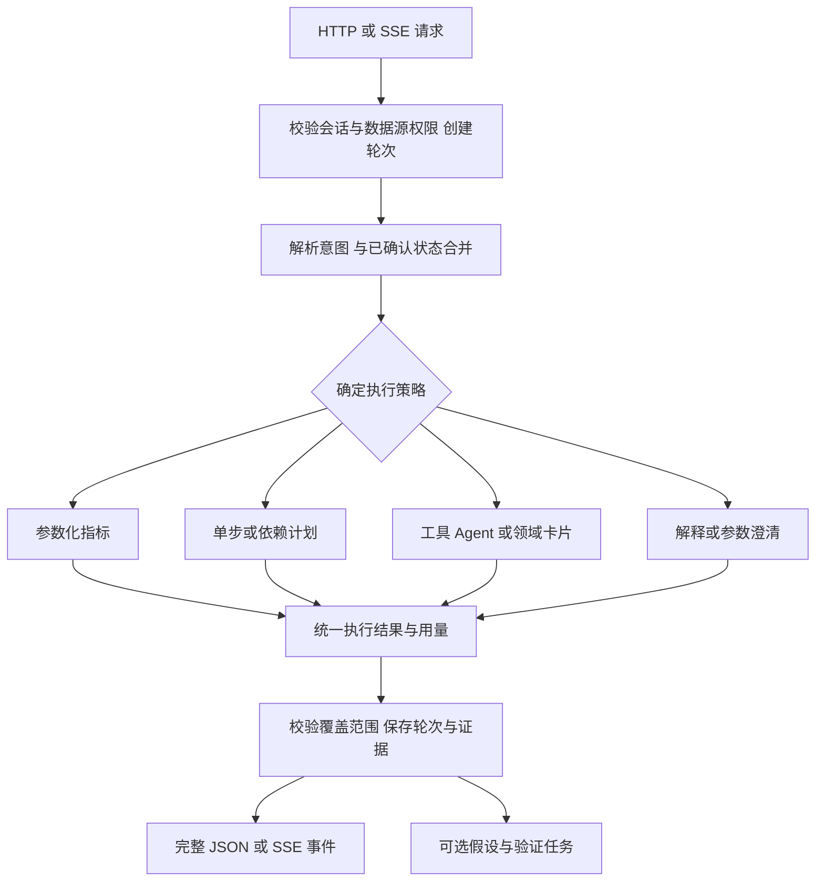

# AIChat Service 功能、兼容性与完整性分析

分析对象：以 `backend/app/services/chat_service.py::ChatService` 为核心，覆盖 chat API、9 个相关 mixin、意图服务、NL2SQL、模型适配器、多步执行、会话状态和前端聊天流。代码版本：`fabd487ded3b7721f645a8c48250936dd18ff638`。

本次只分析与验证，没有修改仓库源码、应用测试、依赖声明或锁文件。结论重新核对当前代码，没有把历史能力评估中已关闭的问题当成当前缺陷。

## 已有功能与实际边界

当前系统已经覆盖：13 类意图、本体类召回与 JOIN 扩展、术语和 Wiki 规则注入、计划生成和引用校验、Oracle/MySQL/PostgreSQL SQL 生成、只读执行、错误回灌、模型切换、查询结果摘要、图表、多步查询、追问状态、供应商卡片、Agent、证据和原因假设。

主要问题集中在这些功能之间的衔接：不同传输入口的能力不对齐；结构化状态没有完整保存业务范围；模型协议差异和数据库返回类型没有在边界统一处理；一些辅助函数虽然有测试，却没有进入实际主链路。

| 功能 | 当前实现 | 完整性边界 |
|---|---|---|
| 普通查询 | 计划 → 校验 → SQL → 执行 → 图表 → 回答 | 多数主路径已具备，复杂 SQL 快捷改写有错误 |
| 多轮追问 | 最近对话、上一轮 SQL/计划、继承快照 | 短追问被提前分成闲聊；时间初始化与流式快照保存有缺口 |
| 指标直答 | KPI 匹配 → 固定 Feature SQL → 快速答复 | 仅非流式接入；没有完整绑定本轮时间、过滤和选择的数据源 |
| 探索性 Agent | 开关 + 关键词 → 工具循环 | 仅非流式的通用 L4 入口接入；显式 AGENT_RUN 在两端都有路径 |
| 复杂问题 | 顺序执行，前序结果文本注入，失败隔离 | 当前有步数上限；依赖关系不是显式 DAG，实体集合可能被截断 |
| 原因分析 | 返回候选假设和验证 SQL | SQL 只保存，不自动执行；目前不是已验证因果结论 |
| 历史回放 | 保存文本和 SQL | 图表、数据、步骤结果没有完整重建 |
| 流式回答 | SSE、块间超时、错误帧、断连落库 | 存在跨块解析、结束语义和前端会话竞态问题 |

## 优先级一：把核心功能接成同一条可靠链路

### 1. 普通请求与流式请求应使用同一个决策与执行核心

代码证据：[chat_service.py:388](/workspace/QA/backend/app/services/chat_service.py:388)、[chat_service.py:409](/workspace/QA/backend/app/services/chat_service.py:409)、[chat_stream.py:166](/workspace/QA/backend/app/services/chat_stream.py:166)、[ChatPage.tsx:65](/workspace/QA/frontend/src/pages/ChatPage.tsx:65)。

普通请求在分类前运行 KPI 快车道和通用 L4 Agent Loop；流式入口没有调用这两个入口，而前端默认走流式。流式已有显式 Agent 和供应商卡片路径，不能把问题扩大成“所有 Agent 在流式不可用”。

影响：同一问题切换流式开关，可能选到不同执行策略、成本和结果能力。非流式新增功能也容易漏接前端默认路径。

建议逐步提取 `prepareTurn`、`resolveStrategy`、`executeTurn`、`finalizeTurn`：决策、计划、执行、状态和计量只保留一份；流式订阅执行事件，普通请求收集相同执行结果。先统一入口分发和结果对象，再迁移后续步骤，不必一次重写全部 mixin。

验收：相同输入、用户、模型、数据源和确定性外部响应，在两个入口产生相同的策略、SQL、数据、卡片、状态和计量；只有输出时间和事件形式不同。

### 2. 修复短追问和带问候的业务问题识别

代码证据：[intent_service.py:551](/workspace/QA/backend/app/services/intent_service.py:551)。

已复现：有历史状态时，“去年呢”“按月呢”“同比”“继续”“汇总”仍返回 CHITCHAT；“你好，请查询2025年采购总额”也被问候前缀直接拦截。长度不超过 3 的规则早于追问判断。

建议：先处理显式指令、业务动词和有状态的省略式追问，再判断纯问候；识别礼貌前缀后分析剩余问题。保留低成本规则，低置信且会改变业务范围的情况再调用语义分类或返回结构化澄清选项。

功能扩展：将“概念解释”与“问题缺少必要参数”的澄清状态区分。目前 CLARIFY 主要是术语解释，不能完整承担时间、指标口径、实体重名等参数澄清。

验收：“你好，请查订单数”执行查询；“去年呢”继承指标和业务对象并改变时间；“谢谢”仍零模型调用；无历史的“同比”询问比较对象，避免生成猜测 SQL。

### 3. 完整保存并隔离每轮查询上下文

代码证据：[models.py:834](/workspace/QA/backend/app/domain/models.py:834)、[chat_context.py:77](/workspace/QA/backend/app/services/chat_context.py:77)、[chat_context.py:489](/workspace/QA/backend/app/services/chat_context.py:489)、[chat_service.py:661](/workspace/QA/backend/app/services/chat_service.py:661)、[chat_stream.py:683](/workspace/QA/backend/app/services/chat_stream.py:683)、[chatStore.ts:175](/workspace/QA/frontend/src/stores/chatStore.ts:175)。

当前有三个缺口：

1. `SessionQueryState` 只按 session_id 唯一，没有数据源、schema、用户或业务范围绑定；前端切换数据源只改 id，仍保留原会话和历史。
2. `_parsePlanTime` 能处理部分时间条件，并有测试，但生产链路没有调用它；SemanticState 的 time/filters 仍为占位，正常首轮快照难以初始化时间。原始计划/SQL仍进入模型上下文，因此不能断言所有时间追问均失败，但确定性继承能力未闭合。
3. 非流式普通单步保存 inheritance_snapshot，流式普通单步没有传该参数，默认值会使快照为空。流式多步已有相关传递，问题主要在单步等出口。

建议保存 `TurnState`：turn_id、datasource/schema、指标、维度、绝对时间区间与业务时区、过滤、排序、行数、计划、实际 SQL、执行状态和版本。状态优先从校验后的计划得到，而不是重新解析回答文本。切换数据源时开启新分支或明确清空不能继承的字段。

统一语义：本轮明确参数覆盖上轮；未提到的参数可继承；取消筛选显式删除；新主题重置；“去年”基于已确认业务时间锚点解析。引入状态版本或每会话排队，处理并发请求的覆盖和初次插入冲突。

验收链：2025 年采购金额 → 去年呢 → 按供应商分组 → 去掉供应商筛选 → 换数据源 → 回到第二轮。检查每一步结构化范围，不只检查回答文字。

### 4. 先校验会话归属，再读取或写入聊天状态

代码证据：[chat.py:40](/workspace/QA/backend/app/api/v1/chat.py:40)、[chat.py:77](/workspace/QA/backend/app/api/v1/chat.py:77)、[chat.py:92](/workspace/QA/backend/app/api/v1/chat.py:92)、[chat_context.py:398](/workspace/QA/backend/app/services/chat_context.py:398)。

已通过真实 PostgreSQL 和真实 HTTP 路由复现：用户 B 查询用户 A 会话的 hypotheses 起初返回 403；B 向相同 sessionId 的 chat POST 发送问候得到 200；此后 B 查询 hypotheses 得到 200。原因是写入没有调用归属守卫，并给该会话追加了 B 的归属标记。

这会破坏多人环境中的对话、历史、证据和状态完整性；查询历史和状态也主要依赖 sessionId。

建议建立独立 Conversation 归属记录，使用服务端用户主键和授权关系校验每个入口；不可通过追加消息获得会话所有权。新会话创建、存量无归属会话、管理员访问应有明确策略。归属和数据源权限也应传给 Agent、指标与断连持久化步骤。

## 优先级二：统一 SQL、模型和数据兼容边界

### 5. 快捷 SQL 改写必须理解语法层级，并同步更新计划

代码证据：[nl2sql_refine.py:92](/workspace/QA/backend/app/services/nl2sql_refine.py:92)、[nl2sql_refine.py:134](/workspace/QA/backend/app/services/nl2sql_refine.py:134)、[nl2sql_refine.py:329](/workspace/QA/backend/app/services/nl2sql_refine.py:329)、[chat_service.py:936](/workspace/QA/backend/app/services/chat_service.py:936)。

已复现：

```sql
-- 请求“前3条”时，字符串业务条件也被改动
SELECT id FROM orders WHERE note = 'LIMIT 10' LIMIT 20
-- 当前结果
SELECT id FROM orders WHERE note = 'LIMIT 3' LIMIT 3
```

还有：嵌套 SQL 内外 LIMIT 同时被替换；只有内层 ORDER BY 时，“按 id 降序”改的是内层，未建立期望的外层排序。快捷路径返回旧 plan 与新 SQL，计划展示和下一轮结构化继承可能不同步。

建议短期把快捷路径限制在确认是简单顶层 SELECT 的查询；遇到 CTE、子查询、窗口函数、特殊字面量等，安全回退现有两阶段生成。中期基于 SQL AST 定位目标层级，同时更新结构化计划，并验证实际 SQL 与计划的过滤、排序、limit 一致。

数据源兼容建议：数据库方言采用显式能力和已探测版本，Oracle 11g/12c+、PostgreSQL schema/search_path、MySQL SQL mode 分别验证。未知数据源当前回退 Oracle 11g，应改为明确不支持或使用经验证适配器。当前正式支持的三类数据源可以保留，新增 SQL Server 等属于扩展建议，不是已有声明能力。

### 6. 将 KPI 快车道补齐为参数化指标查询

代码证据：[chat_service.py:1270](/workspace/QA/backend/app/services/chat_service.py:1270)、[chat_service.py:1334](/workspace/QA/backend/app/services/chat_service.py:1334)、[chat_service.py:1393](/workspace/QA/backend/app/services/chat_service.py:1393)。

匹配结果只有指标身份和分数；执行过程使用 Feature 固定数据源和 SQL，没有接收完整本轮 dto、时间/过滤或追问上下文。执行失败或没有数据时可以返回指标定义，并终止后续流水线。结果文本取第一行第一个非空字段，也不一定是指标值。

建议增加 `MetricQuery`：指标、业务口径版本、时间、维度、过滤、数据源与单位；将“指标定义解释”和“指标值查询”作为不同结果。固定跨源指标应显式告知使用的数据源，避免覆盖用户选择后仍看起来在原数据源查询。

条件不能绑定、执行失败或口径不明确时，返回带原因的降级/澄清，不把定义说明当作查询完成。输出显式 value、unit、period、freshness、provenance，并保存与普通查询一致的状态和步骤。

验收：同一指标问全量、2025 年、2024 年、指定供应商时，执行范围各自正确；查询失败仍可继续普通流程；多维指标不把供应商编码误当数值。

### 7. 按具体模型能力选路由，协议参数应可协商

代码证据：[openai_client.py:187](/workspace/QA/backend/app/infrastructure/llm/openai_client.py:187)、[openai_client.py:206](/workspace/QA/backend/app/infrastructure/llm/openai_client.py:206)、[ollama_client.py:112](/workspace/QA/backend/app/infrastructure/llm/ollama_client.py:112)、[model_router_service.py:61](/workspace/QA/backend/app/services/model_router_service.py:61)。

当前成本/亲和/权重路由没有按任务筛选 streaming、tools、结构化输出等能力。Ollama 的当前应用适配器对 tools 直接抛 NotImplementedError；这不表示所有 Ollama 模型都不支持工具。OpenAI 流式请求固定发送 include_usage，部分兼容代理可能拒绝这一参数。

已用合成 SDK 流块复现：同一块同时包含 usage 与文本时，代码更新 usage 后 continue，导致文本丢失，最后只返回计量信息。

建议将模型能力记录为 supports_stream、supports_tools、supports_json_schema、supports_usage、context_limit、temperature_policy、协议类型和健康状态。先按任务需求筛选，再在合格模型中做成本和亲和路由。通过受控探测或配置协商可选参数；把 usage 和文本作为独立字段消费。

兼容代理缺少 usage 时，应记录 unknown/estimated/measured 的来源，保留可得用量；不要把 0 当成“免费”。当前流式失败审计还有直接写 0/0 的分支，应消费异常已有的 tokens。切换模型/密钥后同步失效客户端缓存。

建议建立契约样例：文本与 usage 同块、无 usage、拒绝 include_usage、空 choices、工具分块、429、400、超时、部分输出失败。原生非 OpenAI 协议支持作为独立适配器扩展。

### 8. 统一数据库结果类型与数据量处理

代码证据：[data_summary.py:131](/workspace/QA/backend/app/services/data_summary.py:131)、[stream_events.py:54](/workspace/QA/backend/app/services/stream_events.py:54)、[business_db_pool.py:537](/workspace/QA/backend/app/infrastructure/business_db_pool.py:537)、[chat_service.py:1758](/workspace/QA/backend/app/services/chat_service.py:1758)。

已复现：结果列是 JSON dict 或数组时，distinct 统计用 set，抛 unhashable TypeError；Infinity 会进入摘要与 SSE JSON，前端 JSON.parse 无法消费。

另外，配置中的 max_input_tokens 没有在 Chat/NL2SQL 主链路作为完整 prompt 的上限使用；历史有字符预算，schema 有裁剪，但 schema、Wiki、样例、字典、步骤和结果组合后的总预算没有统一控制。默认关闭结果行数限制时，数据库适配器会全量取回数据。

建议在数据库出口定义 `QueryResult`：column schema、标准化 rows、row_count、truncated、timezone、decimal precision、来源和执行状态。JSON/数组用稳定序列化或对应摘要；金额和大整数保留精度；日期统一时区；NaN/Infinity 变成显式缺失/异常值。不要任意把所有对象 str() 后期待前端自行猜测。

结果和 prompt 分别控制：页面分页/导出支持全量；模型使用准确聚合、代表样本和针对问题的局部结果。按实际模型 token 预算分配 schema、状态、规则和结果的额度，保留输出空间，避免对话/数据扩大后才收到上下文超限。

## 优先级三：把流式、多步和分析结果做成可恢复功能

### 9. 流式请求必须绑定目标会话和轮次

代码证据：[chat.ts:247](/workspace/QA/frontend/src/api/chat.ts:247)、[chatStore.ts:314](/workspace/QA/frontend/src/stores/chatStore.ts:314)、[chatStore.ts:574](/workspace/QA/frontend/src/stores/chatStore.ts:574)。

3 个临时前端复现检查确认：

- CRLF 的 CR/LF 落在不同网络块时，逐块规范化可制造错误空行并丢失 token；同块 CRLF 已有测试，不覆盖这个边界。
- 流在没有 done/error 时 EOF，sendMessageStream 仍正常 resolve；store 只复位显示状态，不能表示答案完整。
- 请求执行中加载另一会话，旧 onToken 回调修改新会话最后一条消息。

建议为请求固定 conversation_id、turn_id、assistant_message_id，并按该消息更新；切换会话、取消或重发时使用 AbortController 和请求版本校验。SSE 解析器跨块保留未完成 CR；只有收到终态才能标记 completed，提前 EOF 标记 interrupted。

兼容优化：加入心跳、请求超时、稳定错误码、有限重试策略；后端保留 turn 状态与事件序号后再考虑断点续传。重新连接不能重执行付费调用或重复写本体，因此幂等性先于自动重试。

### 10. 多步查询采用显式依赖和覆盖检查

代码证据：[multi_step_plan.py:4](/workspace/QA/backend/app/domain/multi_step_plan.py:4)、[multi_step_plan.py:191](/workspace/QA/backend/app/domain/multi_step_plan.py:191)、[chat_multistep.py:464](/workspace/QA/backend/app/services/chat_multistep.py:464)。

当前顺序执行和失败隔离已存在，但步骤依赖主要用文本注入表达，步数受限，实体列表有长度边界。扩展到“选 Top N → 比较这些对象 → 分析原因”时，应避免依赖实体被截断或前序失败后后续仍推断不存在的集合。

建议第一阶段加入 depends_on、input_refs、output_schema、独立/依赖步骤分类和 failed/skipped/partial 状态；依赖失败则跳过相关步骤，独立步骤继续。结果传引用或临时数据集，不把大实体集合全部塞进提示词。先实现明确依赖，经过验证后再并行独立步骤；不能共享同一个 AsyncSession 并发执行。

每个用户子目标记录 answered/unanswered，汇总只依据成功数据；最后明确哪些目标完成、哪些缺数据、哪些需要额外查询。避免 SQL 执行成功就被当成整个复杂问题回答完整。

### 11. 把假设、证据和图表接成可验证、可回放结果

代码证据：[hypothesis_service.py:1](/workspace/QA/backend/app/services/hypothesis_service.py:1)、[chat_stream.py:717](/workspace/QA/backend/app/services/chat_stream.py:717)、[chatStore.ts:99](/workspace/QA/frontend/src/stores/chatStore.ts:99)。

已有原因假设明确只保存验证 SQL，并不执行；流式 done 前还 await 可选假设生成。历史回放只恢复文字与 SQL，图表、数据和步骤结果没有完整持久化。

建议将“可能解释”与“已验证结果”分别标记，为假设提供用户发起的验证动作：复用授权、SQL Guard、数据库超时和计量，验证结果关联证据与具体 turn。辅助假设生成使用独立任务/会话和状态，避免主回答完成后仍等待第二轮模型调用。

保存版本化 TurnResult：查询解释、指标口径、时间范围、SQL、result_ref、图表配置、步骤状态、证据引用、模型用量和实际完成状态。大数据保存引用而非直接塞入消息表。刷新、历史打开和导出应读取同一结果版本，避免用户看到只有文字的残缺回放。

### 12. 控制一整轮的预算和故障恢复

代码证据：[model_router_service.py:71](/workspace/QA/backend/app/services/model_router_service.py:71)、[chat_usage.py:83](/workspace/QA/backend/app/services/chat_usage.py:83)、[chat_service.py:1684](/workspace/QA/backend/app/services/chat_service.py:1684)、[chat_stream_output.py:43](/workspace/QA/backend/app/services/chat_stream_output.py:43)。

当前会话预算主要促使路由选择较便宜模型，没有统一限制本轮所有拆步、两阶段生成、回灌、回答和辅助分析的总支出。SQL 执行异常整体进入再生成，权限失败、连接失败、超时等并不都能通过改 SQL 修复。

建议区分 provider_transient、provider_protocol、schema_reference、sql_syntax、db_connectivity、permission、query_timeout 等错误；错误恢复分别决定重试同模型、换兼容模型、重建计划、停止并提示外部条件。区分“本模型 key 失效”和“用户请求无权”，不要把某个提供方的永久失败等同于其他提供方不可用。

执行入口携带 request deadline、remaining token/cost budget、最大恢复次数和取消状态，所有子阶段共享额度。对持久化与计量分别设计事务；付费调用不能因前端重试重复执行。延迟指标应从请求入口计时，当前 L1/L4 在执行后才开始某些计时，不能代表完整请求耗时。

## 建议的渐进目标结构



保留现有 IntentService、Nl2SqlService、数据库适配器、供应商服务和 AgentRuntime，新增共享 TurnContext/TurnResult 将它们连接起来。每次只迁移一类功能，旧 API 仍可通过适配层输出，减少已有前端和测试的兼容风险。

## 分阶段落地与验收

| 阶段 | 建议范围 | 交付与验收 |
|---|---|---|
| 第一阶段：修正已复现行为 | 会话归属；短追问；简单 SQL 快捷路径边界；JSON/非有限值；SSE 分块和会话绑定 | 对本报告复现输入建立真实 API/边界回归检查；确认旧会话不可写、文本不丢失、业务字符串不被改写 |
| 第二阶段：统一核心契约 | 两入口统一分发；TurnState/Result；时间/过滤继承；指标参数化；模型能力 | 普通/流式能力对齐；数据源切换后范围隔离；模型能力组合正确路由 |
| 第三阶段：补齐分析闭环 | 多步依赖；目标覆盖；验证假设；结果回放；恢复/预算 | 部分失败有明确状态；历史可恢复图表和步骤；验证结果关联证据；取消和重发不重复收费 |

建议构建固定的业务验收集：单表/多表、绝对和相对时间、中文/英文/混合词、Top N/逐组 Top N、空结果、JSON/数组/Decimal/日期、同名实体、不同数据源/模型、短追问、部分失败、取消和并发、断连和恢复。

跟踪：答案正确率、子目标覆盖率、范围继承正确率、流式/普通一致率、未支持能力的误路由率、断连识别率、首事件/首答案和整体延迟、每轮真实成本及 unknown 用量比例。先采集基线，再设目标；不能用单纯测试通过数代替业务正确性。

## 本次验证范围

- 后端相关现有测试：意图、快捷改写、继承状态、数据摘要，174 个通过。测试 fixtures 依赖真实 PostgreSQL；恢复独立测试数据库并显式设置 TEST_DATABASE_URL 后完成。
- 前端相关现有测试：chat API 18 个、chat store 34 个，共 52 个通过。
- 额外前端复现检查 3 个，确认跨块 CRLF 丢内容、无终态 EOF 正常返回和旧流污染新会话的当前行为。这些检查通过表示缺陷得到复现，不是修复通过。
- 额外直接边界检查确认：短追问与问候问题误分类、正则误改字面量/嵌套 SQL、JSON/数组摘要异常、Infinity 序列化、usage 与文本同块丢文本，以及结构化首轮时间未初始化。
- 会话写入归属问题通过真实应用 HTTP 路由和独立真实数据库复现，不运行应用 lifespan，也没有发送实际模型请求。
- L1/L4 入口差异、继承快照遗漏、指标范围缺失、全量结果/提示词预算、多步依赖及历史回放边界来自当前代码证据，尚未以真实模型和完整外部服务做端到端验证。

因此，本报告给出可直接进入改进任务的缺陷和能力建议，但不宣称已完成系统修复或全栈业务验收。
