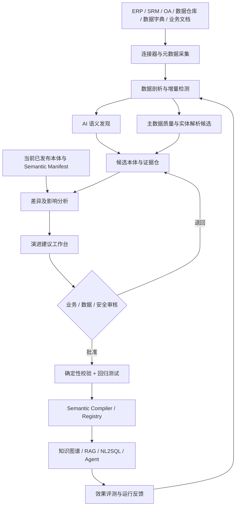

# AI 驱动的本体发现与持续演进引擎——功能设计 V1.0

> 状态：目标功能设计草案；用于架构评审、WBS 变更评估与研发详细设计。**不是 QA-System 当前功能实现声明**。  
> 工作包：`WP-ONT-AI`；目标架构归属：**本体与 AI 核心能力平台 / 本体智能发现与演进引擎**。  
> 关联基线：《智能采购平台总体架构设计方案 V0.2》《采购本体模型与语义编译器详细设计 V0.1》《智能采购平台开发实施方案 V0.2》《研发评估与设计冻结报告 V1.0》。本工作包为建议新增范围，需经过变更评审，不默认计入原有工期与工作量。

## 1. 建设目标、范围与边界

### 1.1 目标

1. 从 ERP、SRM、OA、数据仓库及业务文档中发现**候选**业务对象、属性、关系、分类、指标语义和数据映射。
2. 对供应商、物料、客户等主数据执行剖析，输出疑似重复、属性缺失、分类冲突、编码映射等**治理建议**。
3. 通过增量变化检测与下游应用反馈形成可追溯的本体演进建议，经过审核、测试、编译、版本发布后供图谱、RAG、NL2SQL、Agent 消费。
4. 用证据和可量化指标验证提炼质量、治理效率及下游效果，控制目标偏移。

### 1.2 非目标和红线

- **不自动修改** ERP/SRM/MDM 等权威主数据记录或编码；不将本体管理系统变成主数据管理系统。
- 不允许 LLM 直接将候选变更写入正式本体、自动激活规则或业务动作。
- 不将业务数据实例等同于本体对象类型；新增供应商记录不意味着新增 Supplier 类型。
- 不凭文本相似度自动合并供应商/物料；必须结合唯一标识、规则、业务证据及人工确认。
- 不绕过组织权限、数据分级、脱敏和审计；不将敏感数据无授权发送至外部模型。
- 不默认实现写回业务系统；后续 Action 由 Workflow、审批、幂等和源系统权限单独控制。

## 2. 功能架构



**分层责任：**连接器提供事实；剖析引擎计算统计特征；LLM 提出语义候选与解释；实体解析算法提出匹配候选；审核人确认业务正确性；Compiler/Registry 执行版本化发布；下游系统消费正式版本。

## 3. 功能模块详细设计

| ID | 模块 | 输入 | 核心处理 | 输出 | 关键控制 |
|---|---|---|---|---|---|
| F01 | 数据源登记与连接 | 系统、连接方式、访问范围 | 授权、元数据发现、连接健康检查 | Source Catalog | 最小权限、只读优先 |
| F02 | 元数据与样本采集 | Schema、API、数据字典、样本 | 字段、主键、外键、枚举、数据分布采集 | Metadata Snapshot | 采样限额、脱敏、血缘 |
| F03 | 数据剖析 | 采样或授权统计结果 | 唯一性、空值、值域、分布、关联覆盖率 | Profile Report | 可复现 SQL/规则 |
| F04 | AI 语义发现 | 元数据、样本摘要、业务术语 | 识别对象、属性、关系、分类候选及理由 | Ontology Candidate | 模型版本、Prompt 版本、引用证据 |
| F05 | 主数据智能分析 | 主数据特征、编码规则、映射 | 疑似重复、冲突、异常、分类候选 | Data Quality Finding | 不直接改码/合并 |
| F06 | 本体差异与影响分析 | 候选、已发布 Manifest | 新增/修改/弃用差异、下游依赖检查 | Change Proposal | 兼容性与风险分级 |
| F07 | 审核工作台 | Proposal、证据、责任人 | 审核、驳回、补证、讨论、签审 | Review Decision | 四眼原则、审计 |
| F08 | 编译与发布适配 | 已批准变更 | 规则校验、回归、Manifest 生成、发布 | Versioned Manifest | 不可变版本、回滚 |
| F09 | 增量监测与反馈 | Schema 差异、运行错误、业务反馈 | 触发重新剖析、提案与效果复盘 | Monitoring Event | 去重、节流、阈值 |
| F10 | 质量与运营看板 | 评测集、审核台账、版本历史 | 质量、效率、覆盖率、收益统计 | Dashboard | 基线可追溯 |

### 3.1 AI 语义发现策略

- 输入应优先是**字段元数据、统计摘要、脱敏样本和业务术语**，避免将整表直接送入 LLM。
- 提示词要求结构化输出 JSON，包含 `candidate_type`、`name`、`definition`、`attributes`、`relations`、`evidence_ids`、`confidence`、`uncertainties`、`source_snapshot_id`。
- LLM 的置信度仅作为排序参考，不能替代真实精度评测；必须有确定性 Schema 校验和证据完整性检查。
- 关系推断需结合外键、Join 覆盖率、实际业务流程和样本验证；低置信候选进入人工待确认池。

### 3.2 主数据提炼与治理

- **供应商：**从 ERP/SRM 的编码、社会信用代码、名称、资质、供货范围、绩效字段中提炼 Supplier 属性和跨系统映射候选；疑似重复由业务审核。
- **物料：**从名称、规格、型号、单位、分类提炼 Material 的候选属性模板和分类规则；如“HRB400E Φ20 螺纹钢”可候选提取牌号与直径，但信息不足时标记待确认。
- **客户：**根据业务系统字段提炼 Customer 对象与属性候选；实体合并需遵循客户主数据管理责任与规则。
- **交易事实：**从采购需求、订单、合同、收货记录发现对象间关系，验证已有本体关系的业务覆盖情况。

## 4. 数据模型建议

| 实体 | 关键字段 | 说明 |
|---|---|---|
| `discovery_source` | id, type, owner, access_policy, status | 授权数据源目录 |
| `metadata_snapshot` | id, source_id, schema_hash, captured_at, sample_policy | 采集快照与版本 |
| `profile_result` | id, snapshot_id, object_path, metrics_json, evidence_uri | 数据剖析结果 |
| `ontology_candidate` | id, candidate_kind, payload_json, evidence_refs, score, model_version, status | 候选语义资产 |
| `masterdata_finding` | id, source_refs, issue_type, candidate_refs, severity, status | 主数据问题与建议 |
| `ontology_change_proposal` | id, base_version, diff_json, impact_json, proposer, status | 演进变更单 |
| `ontology_review` | id, proposal_id, reviewer, decision, comment, reviewed_at | 审批与签审 |
| `discovery_run` | id, trigger, snapshot_ids, prompt_version, started_at, finished_at, status | 可复现运行记录 |
| `evaluation_result` | id, run_id, dataset_version, metrics_json, verdict | 评测与验收 |

数据库表名为设计建议，需与 QA-System 现有 PostgreSQL 模型、Ontology Service、Semantic Registry 数据结构进行代码级对齐后冻结。大规模原始数据和文档不应复制到这些元数据表中。

## 5. 核心接口草案

```text
POST /api/ontology-discovery/sources                  登记数据源
POST /api/ontology-discovery/runs                     创建一次发现任务
GET  /api/ontology-discovery/runs/{id}                查询任务状态与证据
GET  /api/ontology-discovery/candidates               候选本体列表
GET  /api/ontology-discovery/findings                 主数据问题候选列表
POST /api/ontology-discovery/proposals                创建变更提案
POST /api/ontology-discovery/proposals/{id}/review    审核/退回
POST /api/ontology-discovery/proposals/{id}/validate  确定性验证及回归
POST /api/ontology-discovery/proposals/{id}/publish   调用既有语义发布服务
GET  /api/ontology-discovery/evaluations              质量评测与趋势
```

所有写入类接口需鉴权、幂等、审计；`publish` 不直接写正式语义表，而调用既有本体治理/Compiler/Registry 的受控发布流程。

## 6. 业务流程与状态机

`DISCOVERED → CANDIDATE → PROPOSED → IN_REVIEW → APPROVED → VALIDATED → PUBLISHED`。任何环节可进入 `REJECTED` / `NEEDS_EVIDENCE`；发布后可以 `DEPRECATED` 或按版本回滚。未经审核或未通过回归测试不得发布。

1. 采集源数据结构和统计特征，生成不可变快照。
2. LLM 生成语义候选，规则与算法生成主数据异常候选。
3. 与已发布本体版本比较，形成变更影响报告。
4. 业务 Owner 审核定义，数据 Owner 审核映射，安全人员审核权限和敏感性。
5. 校验属性类型、关系约束、引用完整性、语义版本兼容性。
6. 对 Graph、RAG、NL2SQL、Agent 的回归用例测试后发布。
7. 收集运行失败、用户修正与新数据变化，形成下一轮候选。

## 7. 权限、安全与运行要求

- 默认只读连接、采样白名单、字段级脱敏；对 PII、商业秘密、合同敏感字段实行数据分类和模型调用策略。
- LLM 输入/输出均记录引用快照、模型版本和 Prompt 版本；对 Prompt 注入、非可信文档和工具调用进行隔离。
- 后台批处理异步执行，支持失败重试、断点续跑、限流、超时、配额和成本统计。
- 关键指标、规则、动作变更实行更高等级审批；任何外部业务写操作不属于本工作包。
- 保留原始证据链接和摘要，不以 LLM 自述作为唯一依据。

## 8. 独立工作包与阶段验收

| 工作包 | 建设阶段 | 必须交付 | 验收证据 | 依赖 |
|---|---|---|---|---|
| WP-ONT-AI-A | 辅助初始化 | 连接器、剖析、语义候选、人工审核界面 | 样本标注集、候选准确率、审核日志 | 数据授权、基础本体 |
| WP-ONT-AI-B | 主数据诊断与差异 | 实体匹配候选、质量台账、差异及影响报告 | 重复/冲突查准率、误报复核、变更案例 | 主数据规则、映射 |
| WP-ONT-AI-C | 持续演进 | 增量检测、审批发布、回滚、运营评测 | 变更端到端演练、回归报告、版本记录 | Compiler/Registry、下游测试 |

建议验收指标：候选准确率/召回率、证据完整率、人工复核耗时、误合并率（应为零自动误合并）、变更发布成功率、回滚演练成功率、下游回归通过率。**具体数值阈值须在试点基线测试后由业务、数据与研发共同签署，不在本草案中虚构承诺。**

## 9. 与现有产品目标和 WBS 的关系

- **目标功能架构：**在本体与 AI 核心能力平台新增“本体智能发现与演进引擎”；与本体管理、数据映射、Semantic Compiler/Registry、RAG、NL2SQL、Agent Runtime 相互连接。
- **范围管理：**作为新增工作包，先做现有代码与数据库能力核验，再评估依赖、人员、工期和成本；不能直接把 A/B/C 三阶段计入既有 V0.2 承诺范围。
- **优先级：**优先在供应商、物料两个主数据对象和供应商寻源只读场景验证；写回业务系统属于另行立项的受控执行范围。
- **防偏要求：**任何开发成果必须映射 `目标ID → 工作包 → 功能需求 → 测试用例 → 证据 → 业务签收`；若仅有 LLM Demo 而无证据、审核、版本、回归，不视为完成。

## 10. 研发待确认问题

1. QA-System 当前本体模型、服务、数据库、图谱、RAG 和 Agent 的代码与部署基线是什么？
2. Semantic Compiler/Registry 是否已实现、实现到何种程度、Manifest 格式和发布接口如何？
3. 可授权连接的 ERP/SRM/数仓范围、接口方式、敏感字段和数据质量基线是什么？
4. 供应商/物料统一标识、跨系统映射、业务标准的最终责任人是谁？
5. LLM 部署方式、模型调用安全策略、预算和评测数据集如何确定？
6. 与现有 V0.2 WBS 的依赖、资源、排期和变更审批如何衔接？

---

**设计冻结原则：**先验证数据可获得、证据可追溯、人工审核可执行、语义版本可回滚，再扩大自动发现覆盖范围。任何“自动提炼”均指生成可审查候选，而非自动替代业务治理决策。
